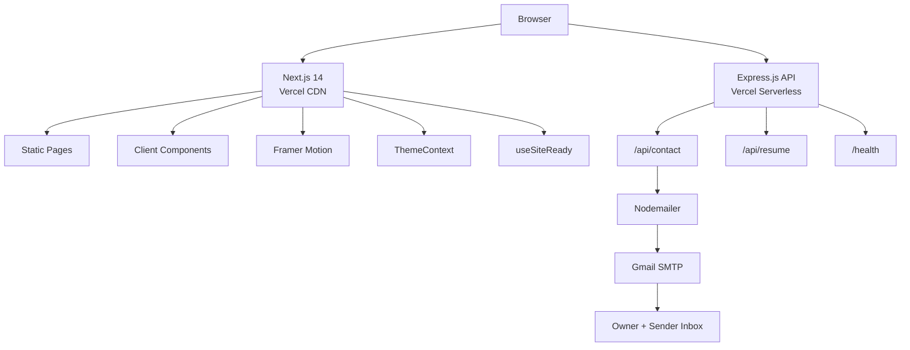
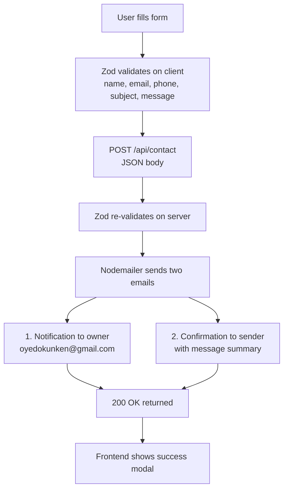
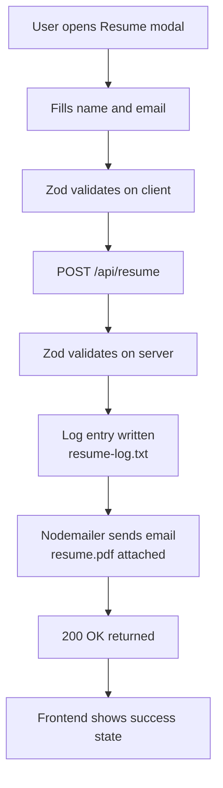
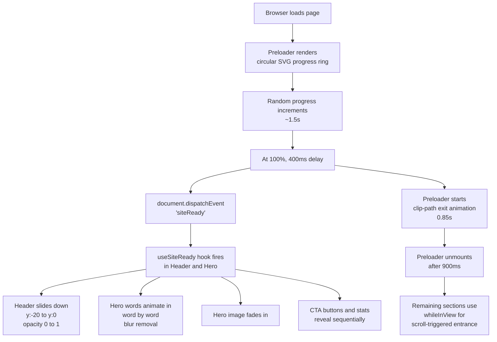

# oyedokun.dev

Personal portfolio and API backend for **Oyedokun Kehinde** — Software Engineer. Built with Next.js 14 on the frontend and Express.js on the backend, deployed as serverless functions on Vercel.

**Live:** [oyedokun.dev](https://oyedokunken.vercel.app/)  
**Repository:** [github.com/oyedokunken/oyedokun-SWE](https://github.com/oyedokunken/oyedokun-SWE)

---

## Table of Contents

- [Overview](#overview)
- [Repository Structure](#repository-structure)
- [Architecture](#architecture)
- [Tech Stack](#tech-stack)
- [Data Flow](#data-flow)
- [Features](#features)
- [Projects Showcased](#projects-showcased)
- [Local Development](#local-development)
- [API Endpoints](#api-endpoints)
- [Deployment](#deployment)
- [License](#license)
- [Contact](#contact)

---

## Overview

This is a production-grade portfolio site built to reflect the same quality standards applied to client work. It is not a template. Every component, animation, and API route was written from scratch.

The frontend is a statically exported Next.js app with App Router, Tailwind CSS, and Framer Motion. The backend is an Express.js serverless API that handles contact form submissions and resume delivery via SMTP.

Key design decisions:
- Preloader with progress ring that gates all entrance animations via a custom `siteReady` event
- Dark and light themes using CSS variables and a React context
- Scroll-spy navigation with active section highlighting
- Rate-limited API with Helmet security headers
- Email templates with HTML/CSS layout for professional delivery

---

## Repository Structure

```text
oyedokun/
  frontend/               Next.js 14 portfolio (deployed to Vercel)
    app/
      layout.tsx          Root layout with metadata, providers
      page.tsx            Main page assembling all sections
      globals.css         CSS variables, Tailwind base, utility classes
    components/
      layout/             Header, Footer, MobileMenu
      sections/           Hero, MarqueeSection, About, Skills, Services, WhyMe, Projects,
                          Experience, Education, Testimonials, PhotoScroll, Contact
      ui/                 Preloader, ResumeModal, Modal, ThemeToggle,
                          ScrollToTop, WhatsAppFloat
    context/              ThemeContext, ResumeModalContext, WhatsAppChatContext
    lib/                  utils.ts, useSiteReady.ts
    public/               Images, fonts, og.png, robots.txt

  backend/                Express.js API (deployed as Vercel Serverless)
    src/
      index.ts            App entry, CORS, Helmet, rate limiting
      routes/
        contact.ts        POST /api/contact
        resume.ts         POST /api/resume
      services/
        mailer.ts         Nodemailer SMTP transport
      templates/
        contact.html      Email template for contact confirmation
        resume-delivery.html  Email template for resume delivery
    resume.pdf            Attached to resume delivery emails
    vercel.json           Serverless function config
```

---

## Architecture



The frontend and backend are separate Vercel projects with independent deployment pipelines. The frontend calls the backend API using the `NEXT_PUBLIC_API_URL` environment variable. Both are stateless and horizontally scalable.

---

## Tech Stack

### Frontend

| Technology | Version | Purpose |
|---|---|---|
| Next.js | 14 (App Router) | React framework, SSG, metadata |
| TypeScript | 5 | Type safety |
| Tailwind CSS | 3 | Utility-first styling |
| Framer Motion | 11 | Animations, scroll-driven effects |
| Lucide React | Latest | Icon system |
| react-phone-number-input | 3 | International phone field |
| Zod | 3 | Form schema validation |
| Axios | 1 | HTTP client |

### Backend

| Technology | Version | Purpose |
|---|---|---|
| Express.js | 4 | HTTP server |
| TypeScript | 5 | Type safety |
| Nodemailer | 6 | SMTP email transport |
| Zod | 3 | Request body validation |
| Helmet | 7 | Security headers |
| express-rate-limit | 7 | Rate limiting (20 req / 15 min) |
| dotenv | 16 | Environment variable loading |

---

## Data Flow

### Contact form submission



### Resume request



### Page load and animation sequence



---

## Features

- Preloader with SVG ring, percentage counter, and `siteReady` event system
- Dark mode default with persistent light mode toggle via ThemeContext
- Scroll-spy navigation with active section indicator dot
- Header entrance animation gated on preloader exit
- Hero: animated word-by-word heading, parallax image, counting stats, green availability dot
- About: animated philosophy statement, subtext paragraph under heading, personal details grid
- Skills: 30 technologies in 6 grouped icon categories (Languages, Frontend, Backend, Data, DevOps, Tools)
- Services: 11 cards with equalized descriptions, distinct SVG patterns (circles, squares, diamonds, lines), no em dashes
- Projects: 22 projects filterable by category (Platform, SaaS, SaaS/AI, Blockchain, Healthcare, EdTech, E-commerce, Agency, WordPress); real cover image per card rendered in greyscale (colour reveals on hover); category pill and icon links use black bg only (no theme toggle); bottom section (bg, title, desc, tags) fully theme-responsive
- Experience: animated scroll-driven timeline line, spring-pop dots, impact-focused bullet points
- Education: FUTA B.Tech, Cipher Software cert, Aspire Leaders Program (Harvard collab) in card grid (currently hidden)
- WhyMe: 6 USP cards with alternating elevated backgrounds (cards 2/4/6 elevated at rest)
- Testimonials: quote cards with avatar images
- Photo scroll: infinite bidirectional marquee in two rows
- Contact: form with field icons, Zod validation, rate-limited API, success/error modal
- CV modal: name and email form, PDF delivery via Nodemailer
- Open Graph and Twitter card metadata with custom 1200x630 OG image
- Sitemap and robots.txt for search engine indexing
- WhatsApp float button with "Let's chat" sticky label; opens chat modal with avatar, "Active Now" status, and conversation-style message bubble
- Scroll-to-top button with circular SVG progress ring that fills as user scrolls
- Marquee: infinite horizontal scroll of 15 selected skills after Hero section
- Responsive across mobile, tablet, and desktop

---

## Projects Showcased

| Project | Category | Live URL |
|---|---|---|
| Ren Power | Platform | [renpowerltd.com](https://renpowerltd.com) |
| RIOS | SaaS | [www.riosintell.com](https://www.riosintell.com) |
| MSP Reports | SaaS | [mspreports.com.au](https://mspreports.com.au) |
| Glore | Platform | [gloreenergy.com](https://gloreenergy.com) |
| Credence | Blockchain | [credencely.vercel.app](https://credencely.vercel.app) |
| Traqify | SaaS | [traqify.vercel.app](https://traqify.vercel.app) |
| Storebook | SaaS | [storebookpro.com](https://storebookpro.com) |
| EduPilot | EdTech | [edupilotly.vercel.app](https://edupilotly.vercel.app) |
| Rexta | Web App | [rextatech.com](https://rextatech.com) |
| Kwiker | Platform | [kwiker-main.vercel.app](https://kwiker-main.vercel.app) |
| TitanBid | SaaS / AI | [titan-bid-frontend.vercel.app](https://titan-bid-frontend.vercel.app) |
| GramOne | Platform | [gramone.vercel.app](https://gramone.vercel.app) |
| Dubai Avenue Scents | E-commerce | [dubaiavenuescent.com](https://dubaiavenuescent.com) |
| DPA Summit | Platform | [digitalprocurement.africa](https://digitalprocurement.africa) |
| FUTA HMS | Healthcare | [futahms.vercel.app](https://futahms.vercel.app) |
| Ascentor LDP | Platform | [ascentorbi.com](https://ascentorbi.com) |
| Cooper Gaming Services | Agency | [coopergamingservices.com](https://coopergamingservices.com) |
| Glory Fashion | WordPress | [glorybyjes.com](https://glorybyjes.com) |
| Noble Land Africa | WordPress | [noblelandafrica.com](https://noblelandafrica.com) |
| NextStars | WordPress | [nexstars.org](https://nexstars.org) |
| WIME Awards | WordPress | [wimeawards.org](https://wimeawards.org) |
| Minuteman | E-commerce | [minuteman.com.ng](https://minuteman.com.ng) |

---

## Local Development

### Prerequisites

- Node.js 20+
- npm 10+

### Clone

```bash
git clone https://github.com/oyedokunken/oyedokun-SWE.git
cd oyedokun-SWE
```

### Frontend

```bash
cd frontend
npm install
npm run dev
```

Runs on `http://localhost:3000`.

Create `frontend/.env.local`:

```bash
NEXT_PUBLIC_API_URL=http://localhost:4000
```

### Backend

```bash
cd backend
npm install
npm run dev
```

Runs on `http://localhost:4000`.

Create `backend/.env`:

```bash
PORT=4000
FRONTEND_URL=http://localhost:3000
SMTP_HOST=smtp.gmail.com
SMTP_PORT=587
SMTP_USER=your_gmail@gmail.com
SMTP_PASS=your_app_password
OWNER_EMAIL=your_email@gmail.com
```

Gmail requires an App Password, not your account password. Generate one at `myaccount.google.com/apppasswords` with 2FA enabled.

### Resume PDF

Place your resume at `backend/resume.pdf`. It is attached automatically to every resume delivery email.

---

## API Endpoints

| Method | Path | Description |
|---|---|---|
| GET | / | Health check |
| GET | /health | Health check |
| POST | /api/contact | Send contact message |
| POST | /api/resume | Request resume delivery |

### POST /api/contact

Body:

```json
{
  "name": "string (min 2)",
  "email": "string (valid email)",
  "phone": "string (E.164 format)",
  "subject": "string (min 3)",
  "message": "string (min 10)"
}
```

Sends a notification email to the owner and a confirmation to the sender.

### POST /api/resume

Body:

```json
{
  "name": "string (min 2)",
  "email": "string (valid email)"
}
```

Logs the request and delivers `resume.pdf` via SMTP.

### Rate Limiting

All `/api/*` routes are limited to 20 requests per 15 minutes per IP.

---

## Deployment

See `frontend/DEPLOY.md` and `backend/DEPLOY.md` for full step-by-step Vercel deployment guides including environment variable setup, SMTP configuration, and file bundling.

---

## License

MIT. See [LICENSE](./LICENSE).

---

## Contact

Email: [oyedokunken@gmail.com](mailto:oyedokunken@gmail.com)  
LinkedIn: [linkedin.com/in/oyedokun](https://www.linkedin.com/in/oyedokunken/)  
Twitter/X: [x.com/oyedokunken_](https://x.com/oyedokunken_)  
Portfolio: [oyedokun.dev](https://oyedokun.vercel.app/)
