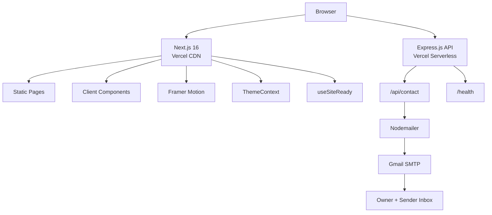
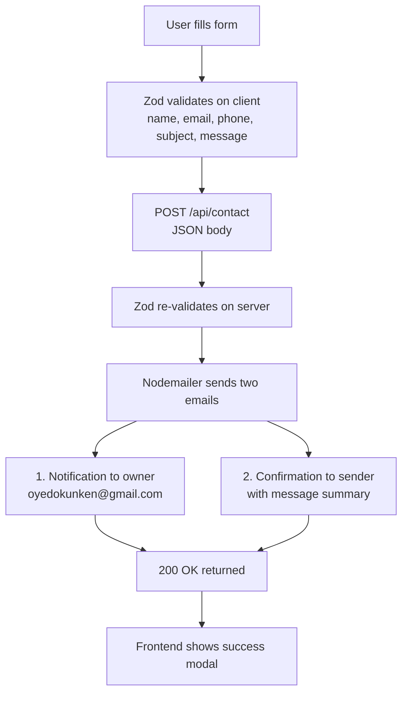
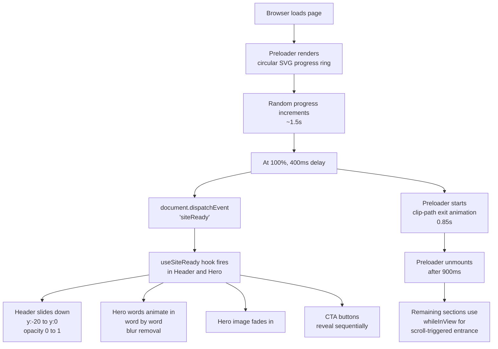

# oyedokun.dev

Personal portfolio and contact API backend for Oyedokun Kehinde. Built with Next.js 16, Express.js, and Tailwind CSS. Features custom animations, dark and light themes, security-hardened endpoints, and a project showcase. Deployed as serverless functions on Vercel.

**Live:** [https://www.oyedokun.dev](https://www.oyedokun.dev)  
**Repository:** [https://github.com/oyedokunken/oyedokun-SWE](https://github.com/oyedokunken/oyedokun-SWE)  
**Buy me a malt:** [https://buymeamalt.com/@oyedokunken](https://buymeamalt.com/@oyedokunken)

---

## Table of Contents

- [Overview](#overview)
- [Repository Structure](#repository-structure)
- [Architecture](#architecture)
- [Tech Stack](#tech-stack)
- [Data Flow](#data-flow)
- [Features](#features)
- [Selected projects](#selected-projects)
- [Local Development](#local-development)
- [API Endpoints](#api-endpoints)
- [Deployment](#deployment)
- [License](#license)
- [Contact](#contact)

---

## Overview

This is a production-grade portfolio site built to reflect the same quality standards applied to client work. It is not a template. Every component, animation, and API route was written from scratch.

The frontend is a Next.js 16 app (App Router, prerendered pages) with Tailwind CSS and Framer Motion. The backend is an Express.js serverless API that handles contact form submissions via SMTP.

Key design decisions:
- Preloader with progress ring that gates all entrance animations via a custom `siteReady` event
- Dark and light themes using CSS variables and a React context
- Scroll-spy navigation with active section highlighting
- Rate-limited API with Helmet security headers, strict CORS allowlist, honeypot and per-recipient limits
- Frontend security headers (CSP, HSTS, X-Frame-Options, Permissions-Policy) set in `next.config.mjs`
- User input is HTML-escaped before it reaches any outgoing email
- Email templates with HTML/CSS layout for professional delivery

---

## Repository Structure

```text
oyedokun/
├── frontend/                       # Next.js 14 portfolio (deployed to Vercel)
│   ├── app/
│   │   ├── layout.tsx              # Root layout: metadata, providers, theme
│   │   ├── page.tsx                # Main page assembling all sections
│   │   ├── globals.css             # CSS variables, Tailwind base, utilities
│   │   └── sitemap.ts              # Dynamic sitemap
│   ├── components/
│   │   ├── layout/                 # Header, Footer, MobileMenu
│   │   ├── sections/               # Hero, MarqueeSection, About, Skills, Services,
│   │   │                           # WhyMe, Projects, Experience, Education,
│   │   │                           # Testimonials, PhotoScroll, Contact
│   │   └── ui/                     # Preloader, Modal, ThemeToggle,
│   │                               # ScrollToTop, WhatsAppFloat
│   ├── context/                    # ThemeContext, WhatsAppChatContext
│   ├── data/                       # projects.ts (portfolio project list)
│   ├── lib/                        # api.ts, utils.ts, useSiteReady.ts
│   └── public/                     # covers/, shoot/, fonts, og.png, robots.txt
│
└── backend/                        # Express.js API (Vercel Serverless)
    ├── src/
    │   ├── index.ts                # App entry: CORS allowlist, Helmet, rate limiting
    │   ├── validation.ts           # Zod schemas (length limits, honeypot)
    │   ├── recipientLimit.ts       # Per-recipient email cap
    │   ├── routes/
    │   │   └── contact.ts          # POST /api/contact
    │   └── services/
    │       └── mailer.ts           # Nodemailer transport + inline HTML email templates
    └── vercel.json                 # Serverless function config
```

---

## Architecture



The frontend and backend are separate Vercel projects with independent deployment pipelines. The frontend calls the backend API using the `NEXT_PUBLIC_API_URL` environment variable. Both are stateless and horizontally scalable.

---

## Tech Stack

### Frontend

| Technology | Version | Purpose |
|---|---|---|
| Next.js | 16 (App Router) | React framework, prerendering, metadata, security headers |
| React | 19 | UI library |
| TypeScript | 5 | Type safety |
| Tailwind CSS | 3 | Utility-first styling |
| Framer Motion | 14 | Animations, scroll-driven effects |
| Lucide React | Latest | Icon system |
| react-phone-number-input | 3 | International phone field |
| Zod | 3 | Form schema validation |

### Backend

| Technology | Version | Purpose |
|---|---|---|
| Express.js | 4 | HTTP server |
| TypeScript | 5 | Type safety |
| Nodemailer | 10 | SMTP email transport |
| Zod | 3 | Request body validation |
| Helmet | 7 | Security headers |
| express-rate-limit | 7 | Rate limiting (20 req / 15 min) |
| dotenv | 16 | Environment variable loading |

---

## Data Flow

### Contact form submission



### Page load and animation sequence



---

## Features

- Preloader with SVG ring, percentage counter, and `siteReady` event system
- Dark mode default with persistent light mode toggle via ThemeContext
- GitHub activity heatmap with responsive sizing, a mobile past 1 month calendar plus 2M, 3M, 6M and 1Y ranges derived from the same hourly data, a desktop last-year view with a real year switcher, no scrolling, and viewport-clamped tooltips
- Scroll-spy navigation with active section indicator dot
- Header entrance animation gated on preloader exit
- Hero: animated word-by-word heading, parallax image, green availability dot
- About: animated philosophy statement, subtext paragraph under heading, personal details grid
- Skills: 30 technologies in 6 grouped icon categories (Languages, Frontend, Backend, Data, DevOps, Tools)
- Services: 11 cards with equalized descriptions, distinct SVG patterns (circles, squares, diamonds, lines), no em dashes
- Projects: filterable project showcase with real cover images rendered in greyscale (colour reveals on hover); category pill and icon links use black bg only (no theme toggle); bottom section (bg, title, desc, tags) fully theme-responsive
- Experience: animated scroll-driven timeline line, spring-pop dots, impact-focused bullet points
- Education: 5 cards - FUTA Akure B.Tech (Computer Information Systems, CGPA 4.72/5.00), Amazon Professional Software Development Certification, NACOSS FUTA Hackathon Emerging Award, Cipher Full Stack cert, Aspire Leaders Program (Harvard collab)
- WhyMe: 6 USP cards with alternating elevated backgrounds (cards 2/4/6 elevated at rest); card 04 is "AI-Augmented Delivery"
- Testimonials: quote cards with avatar images
- Projects: theme-aware "New" pill beside the title for entries carrying an `addedOn` date, auto-expiring after 30 days
- Photo scroll: infinite bidirectional marquee of 58 photos in two rows
- Contact: form with field icons, Zod validation, rate-limited API, success/error modal
- Open Graph and Twitter card metadata with custom 1200x630 OG image
- Sitemap and robots.txt for search engine indexing
- WhatsApp float button with "Let's chat" sticky label; opens an authentic chat modal with avatar and "Active Now" status, video/voice call icons, a live date pill, an end-to-end encryption notice, a welcome bubble with a live timestamp, and a mobile-only input bar (emoji, sticker, paperclip, mic/send)
- Scroll-to-top button with circular SVG progress ring that fills as user scrolls
- Marquee: infinite horizontal scroll of all 30 tools-of-the-trade after the Hero section; pauses on pointer interaction
- Responsive across mobile, tablet, and desktop

---

## Selected projects

| Project | Category | Live URL |
|---|---|---|
| Job Central | SaaS | [jobcentrall.vercel.app](https://jobcentrall.vercel.app) |
| Gistroom | Platform | [gistroom.vercel.app](https://gistroom.vercel.app) |
| Credence | Blockchain | [credencely.vercel.app](https://credencely.vercel.app) |
| Ren Power | Platform | [renpowerltd.com](https://renpowerltd.com) |
| MSP Reports | SaaS | [mspreports.com.au](https://mspreports.com.au) |
| Traqify | SaaS | [traqify.vercel.app](https://traqify.vercel.app) |
| RIOS | SaaS | [www.riosintell.com](https://www.riosintell.com) |
| Prompt AI | SaaS / AI | [prompt-swe.vercel.app](https://prompt-swe.vercel.app) |
| Storebook | SaaS | [storebookpro.com](https://storebookpro.com) |
| Trustbag | SaaS | [trustbag.vercel.app](https://trustbag.vercel.app) |

---

## Local Development

### Prerequisites

- Node.js 20+
- npm 10+

### Clone

```bash
git clone https://github.com/oyedokunken/oyedokun-SWE.git
cd oyedokun-SWE
```

### Frontend

```bash
cd frontend
npm install
npm run dev
```

Runs on `http://localhost:3000`.

Create `frontend/.env.local`:

```bash
NEXT_PUBLIC_API_URL=http://localhost:4000
```

### Backend

```bash
cd backend
npm install
npm run dev
```

Runs on `http://localhost:4000`.

Create `backend/.env`:

```bash
PORT=4000
FRONTEND_URL=http://localhost:3000
SMTP_HOST=smtp.gmail.com
SMTP_PORT=587
SMTP_USER=your_gmail@gmail.com
SMTP_PASS=your_app_password
OWNER_EMAIL=your_email@gmail.com
```

Gmail requires an App Password, not your account password. Generate one at `myaccount.google.com/apppasswords` with 2FA enabled.

---

## API Endpoints

| Method | Path | Description |
|---|---|---|
| GET | / | Health check |
| GET | /health | Health check |
| POST | /api/contact | Send contact message |

### POST /api/contact

Body:

```json
{
  "name": "string (2-100)",
  "email": "string (valid email, max 254)",
  "phone": "string (E.164 format, max 30, optional)",
  "subject": "string (3-150)",
  "message": "string (10-5000)",
  "website": "honeypot, must be left empty"
}
```

Sends a notification email to the owner and a confirmation to the sender.

### Rate Limiting

All `/api/*` routes are limited to 20 requests per 15 minutes per IP. Each recipient email is additionally capped at 3 requests per hour (best-effort, in-memory). Request bodies are capped at 10 KB.

### CORS

Only `https://www.oyedokun.dev`, `https://oyedokun.dev`, `https://oyedokunken.vercel.app` and any origins listed in `FRONTEND_URL` (comma-separated) are allowed. `http://localhost:3000` is allowed outside production. There is no wildcard fallback.

---

## Deployment

See `frontend/DEPLOY.md` and `backend/DEPLOY.md` for full step-by-step Vercel deployment guides including environment variable setup, SMTP configuration, and file bundling.

The repository uses two Vercel projects: the frontend project serves `www.oyedokun.dev` and must use `frontend` as its Root Directory, while the backend project must use `backend` as its Root Directory. Deployments are triggered by pushing to `main`. Do not run `vercel --prod` from inside a subfolder when a Root Directory is configured, because the CLI uploads only that folder and the build fails with a missing Root Directory error.

---

## License

MIT. See [LICENSE](./LICENSE).

---

## Contact

Email: [oyedokunken@gmail.com](mailto:oyedokunken@gmail.com)  
LinkedIn: [linkedin.com/in/oyedokun](https://www.linkedin.com/in/oyedokunken/)  
Twitter/X: [x.com/oyedokunken_](https://x.com/oyedokunken_)  
Portfolio: [oyedokun.dev](https://oyedokun.vercel.app/)
